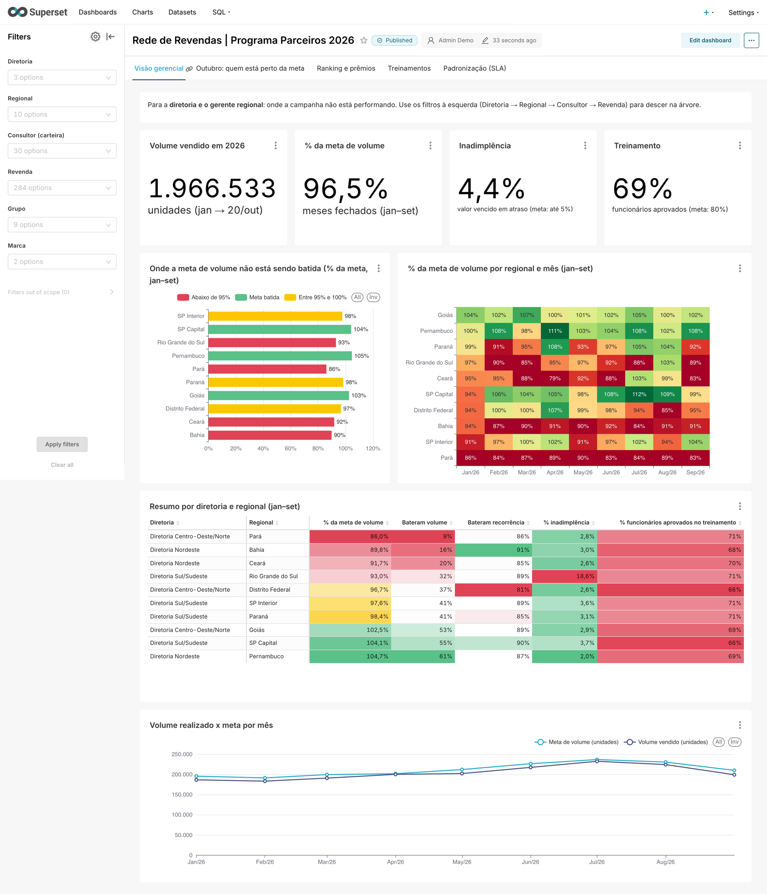
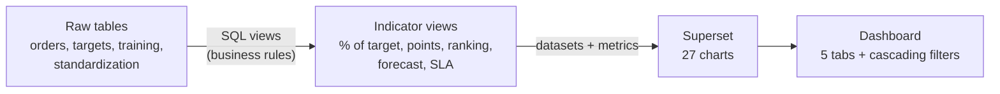
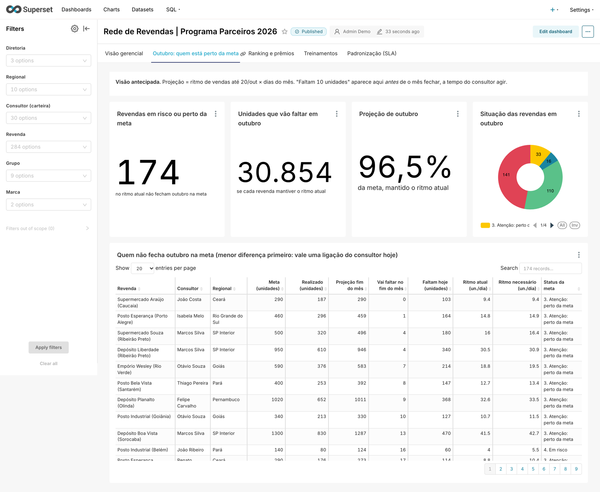
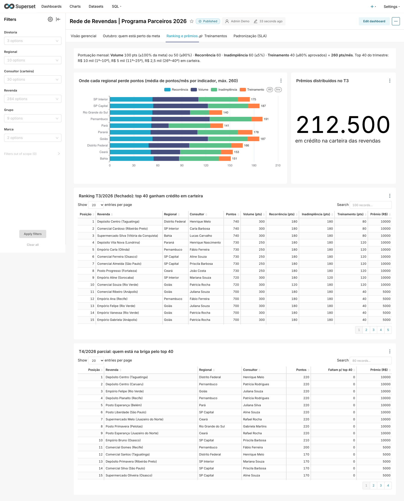
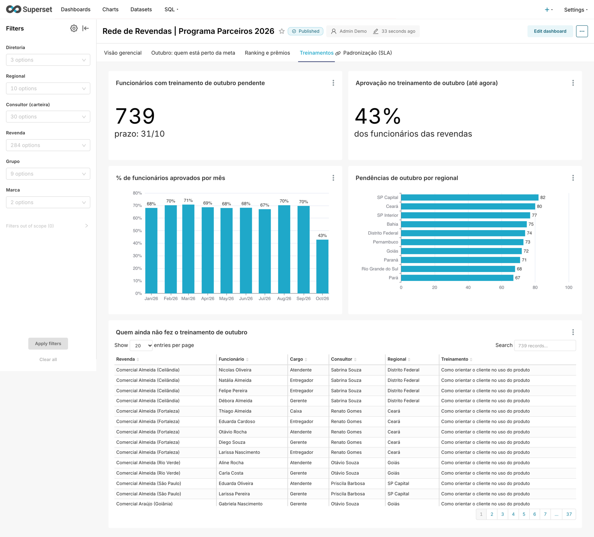
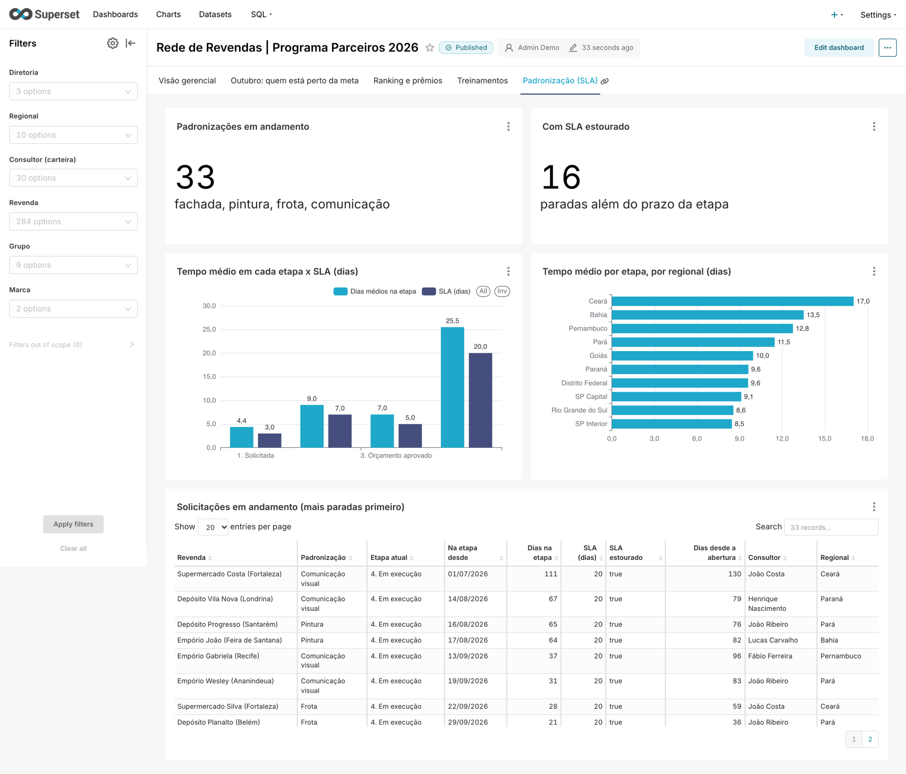

# Reseller Network Analytics with PostgreSQL + Apache Superset

🇧🇷 [Leia em português](README.pt-BR.md)

Sales performance dashboard for a distributor selling through a network of 300 resellers: volume targets,
overdue payments, a points-based incentive program with quarterly prizes, staff training and store standardization.

> **Real problem, fictional data.** Prototype built from a Brazilian client's brief, so the dashboard and the database
> are in Portuguese (see the [glossary](#glossary)). All data is fictional for confidentiality.



## The problem

A distributor sells to a network of resellers (neighborhood stores, gas stations, supermarkets), organized as
**Division → Region → Sales rep portfolio → Reseller**. To keep the network engaged, it runs a points program:

| Monthly indicator | Rule | Points |
|---|---|---|
| Volume | ≥ 100% of target (50 pts if ≥ 90%) | 100 |
| Order frequency | number of orders ≥ target | 60 |
| Overdue payments | ≤ 5% of amount due paid late | 60 |
| Training | ≥ 80% of staff passed | 40 |

The top 40 resellers of each quarter earn credit (R$ 10k / 5k / 2.5k).

The questions the sales team needs to answer:

1. **Where** is the target being missed, and is it volume, overdue payments or training?
2. **Who will close the month below target**, early enough for the sales rep to call *before* the month ends?
3. Where does the ranking stand, and who is close to the top 40?
4. Who hasn't completed this month's training yet?
5. Which store standardization jobs are stuck beyond their SLA?

## How I solved it



**1. Data modeling (`db/01_schema.sql`).** Tables mirror what a transactional system would export: normalized, with
no precomputed indicators. Analysts rarely get data that is ready for a chart.

**2. Synthetic data with a story (`db/02_gerar_dados.py`).** The data is not purely random. Each region has a
profile, so the dashboard has something to reveal:

- Pará and Ceará sell well below target; Bahia, Rio Grande do Sul and Distrito Federal fall slightly short.
- Rio Grande do Sul has an overdue payments problem (~18%, against ~3% elsewhere).
- The Northeast is slower on standardization jobs.
- Training stays below 80% across the whole network.
- Sales are seasonal (higher in winter), and there is a tie at 40th place in the ranking, broken by volume.

That adds up to 300 resellers, ~18k orders, 3k monthly targets, ~1,500 employees and ~11k training answers.
The seed is fixed, so everyone who runs it sees exactly the same numbers.

**3. Business rules live in SQL, not in charts (`db/03_views.sql`).** All the logic sits in versioned, testable
views, and Superset only reads the result. The rule is the same in every chart, in SQL Lab or in an export.

| View | What it delivers | Techniques |
|---|---|---|
| `vw_revenda` | flattened sales hierarchy | JOINs, `LEFT JOIN` + `COALESCE` |
| `vw_kpi_mensal` | reseller × month: % of target, overdue payments, training, points | CTEs, `FILTER`, `LEFT JOIN` from targets (a month with no orders counts as zero), `NULLIF` |
| `vw_projecao_mes_atual` | current-month forecast from the sales pace, plus status | date arithmetic, `CASE` |
| `vw_ranking_trimestre` | ranking, prize and "points missing to reach the top 40" | `RANK() OVER (PARTITION BY …)`, `date_trunc('quarter')` |
| `vw_treinamento_status` | passed / failed / pending / not taken, per employee | `CROSS JOIN` + `LEFT JOIN` to find who did *not* take it |
| `vw_padronizacao` | current stage of each job and SLA breaches | `DISTINCT ON` |

One detail: the views use a **reference date** stored in the database instead of `CURRENT_DATE`. Numbers don't
change on their own from one day to the next, and you can reproduce "what the dashboard looked like on day X".

**4. Dashboard as code (`setup/montar_dashboard.py`).** The connection, datasets, metrics, all 27 charts, the layout
and the filters are created through the **Superset REST API**, with no clicking. The dashboard is versioned in Git and
rebuilt from scratch in seconds.

## The dashboard

| Tab | For whom | What it shows |
|---|---|---|
| Visão gerencial *(management overview)* | division and regional managers | KPIs, % of target by region (traffic light), region × month heatmap, summary |
| Outubro: quem está perto da meta *(who is close to target)* | sales rep | month-end forecast, at-risk resellers sorted by "units still missing" |
| Ranking e prêmios *(ranking and prizes)* | everyone | where each region loses points, closed and in-progress quarter rankings |
| Treinamentos *(training)* | sales rep, HR | pass rate by month and who hasn't taken this month's training |
| Padronização (SLA) *(store standardization)* | operations | time per stage vs. SLA, stuck jobs |

Filters **cascade**: picking a division narrows the regions, which narrow the sales reps, which narrow the resellers.

**Who is close to target.** The forecast uses the sales pace so far, so the sales rep sees who won't hit the month's
target while there is still time to act.



<details>
<summary><b>More screens: ranking, training and standardization</b></summary>







</details>

## Plain SQL analysis

Beyond the dashboard, [`analises/perguntas_de_negocio.sql`](analises/perguntas_de_negocio.sql) answers ad hoc
business questions directly in the database:

| Question | Technique | Finding |
|---|---|---|
| ABC analysis: who drives 80% of volume? | running `SUM() OVER` | 61% of resellers (class A) account for 80% of volume |
| Who declined 3 months in a row? | `LAG()`, `BOOL_AND` | uses % of target instead of raw volume, so seasonality isn't mistaken for decline |
| Who never hit the target in any month? | `HAVING NOT BOOL_OR(...)` | almost all of them in Pará |
| Overdue payments aging by region | `SUM() FILTER` as a pivot | Rio Grande do Sul at 17.9% overdue, ~R$ 550k more than 60 days late |
| Does training help sales? | `CORR()` | correlation ≈ 0 in this data: the dashboard shouldn't promise what the data doesn't show |
| Which sales rep to prioritize today? | `RANK()` over an aggregate | ranking by units the portfolio will fall short |
| Trend without the noise | 3-month moving average, `ROWS BETWEEN 2 PRECEDING` | Pará steady around 85%, SP Capital above 100% |

## Running it

All you need is [Docker](https://www.docker.com/products/docker-desktop/).

```bash
git clone https://github.com/viniciusbedum/vb-reseller-analytics.git
cd vb-reseller-analytics
docker compose up -d
```

The first run takes a few minutes to build and load. Then:

- **Dashboard:** http://localhost:8088/superset/dashboard/rede-revendas/ (user `admin`, password `admin`)
- **SQL Lab** (inside Superset): *SQL → SQL Lab*, database "Rede de Revendas (dados fictícios)", schema `rede`
- **External SQL client** (DBeaver, psql…): `localhost:5433`, database `revendas`, user and password `analista`

Ports already in use? `SUPERSET_PORT=8090 DB_PORT=5434 docker compose up -d`.
To rebuild the data from scratch: `docker compose down -v && docker compose up -d`.

Superset itself is not part of this repository: the official `apache/superset` image is pulled from Docker Hub.

## Project structure

```
├── docker-compose.yml          Postgres + Superset + a one-off container that loads everything
├── db/
│   ├── 00_criar_banco.sql      analysis database and user
│   ├── 01_schema.sql           raw tables
│   ├── 02_gerar_dados.py       synthetic data generator (fixed seed)
│   └── 03_views.sql            indicators and business rules
├── setup/
│   ├── run.py                  orchestration: data → views → dashboard
│   └── montar_dashboard.py     creates datasets, charts and dashboard through the REST API
├── analises/
│   └── perguntas_de_negocio.sql   ad hoc business questions
└── superset/                   Superset image and config (Brazilian number format)
```

## Next steps in a real deployment

- **Role-based access:** with Superset's Row Level Security, each sales rep sees only their own portfolio and each
  regional manager only their region, in the same dashboard.
- **Embedded dashboard** in the distributor's portal or app (Embedded SDK).
- **Incremental loads** from the source system, turning views into materialized tables if volume grows.
- **Alerts:** a scheduled email report to each sales rep listing the at-risk resellers in their portfolio.

## Glossary

The dashboard and the database use Portuguese terms:

| Portuguese | English |
|---|---|
| revenda | reseller |
| diretoria / regional | division / region |
| carteira, consultor | sales rep portfolio, sales rep |
| meta, volume | target, sales volume |
| pedido, recorrência | order, order frequency |
| inadimplência | overdue payments |
| treinamento, funcionário | training, employee |
| padronização, etapa | store standardization, stage |
| pontos, prêmio | points, prize |
| mês fechado, projeção | closed month, forecast |

## Stack

PostgreSQL 17 · Apache Superset 5.0 · Python (psycopg2, requests) · Docker Compose
