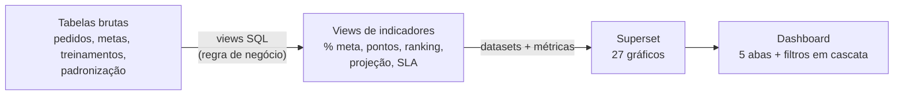

# Análise de uma rede de revendas com PostgreSQL + Apache Superset

🇺🇸 [Read in English](README.md)

Dashboard de acompanhamento comercial de uma distribuidora que vende para uma rede de 300 revendas:
metas de volume, inadimplência, programa de pontos com prêmios trimestrais, treinamentos e padronização de lojas.

> **O problema é real; os dados, não.** Protótipo feito a partir do briefing de um cliente, com dados fictícios por confidencialidade.


## O problema

Uma distribuidora vende para uma rede de revendas (lojas de bairro, postos, supermercados), organizada em
**Diretoria → Regional → Carteira do consultor → Revenda**. Para engajar a rede, ela roda um programa de pontos:

| Indicador (por mês) | Regra | Pontos |
|---|---|---|
| Volume | ≥ 100% da meta (50 pts se ≥ 90%) | 100 |
| Recorrência | nº de pedidos ≥ meta | 60 |
| Inadimplência | ≤ 5% do valor vencido em atraso | 60 |
| Treinamento | ≥ 80% dos funcionários aprovados | 40 |

As 40 revendas com mais pontos no trimestre ganham crédito (R$ 10 mil / 5 mil / 2,5 mil).

As perguntas que o time comercial precisa responder:

1. **Onde** a meta não está sendo batida, e é volume, inadimplência ou treinamento?
2. **Quem vai fechar o mês abaixo da meta**, a tempo de o consultor ligar *antes* de o mês acabar?
3. Como está o ranking, e quem está perto de entrar no top 40?
4. Quem ainda não fez o treinamento do mês?
5. Onde as obras de padronização de loja estão paradas além do prazo (SLA)?

## Como resolvi



**1. Modelagem (`db/01_schema.sql`).** As tabelas ficam no formato em que viriam do sistema transacional, normalizadas
e sem nenhum indicador pronto. Um analista quase nunca recebe dado "pronto para gráfico".

**2. Dados simulados com intenção (`db/02_gerar_dados.py`).** Os dados não são aleatórios puros. Cada regional tem
um perfil, para que o dashboard tenha algo a revelar:

- Pará e Ceará vendem bem abaixo da meta; Bahia, Rio Grande do Sul e Distrito Federal ficam um pouco abaixo.
- Rio Grande do Sul tem um problema de inadimplência (~18%, contra ~3% no resto).
- O Nordeste demora mais nas obras de padronização.
- O treinamento fica abaixo dos 80% em toda a rede.
- Há sazonalidade (o produto vende mais no inverno) e um empate na 40ª posição do ranking, decidido por volume.

São 300 revendas, ~18 mil pedidos, 3 mil metas mensais, ~1.500 funcionários e ~11 mil respostas de treinamento.
A seed é fixa: todo mundo que rodar vê exatamente os mesmos números.

**3. Regra de negócio em SQL, não no gráfico (`db/03_views.sql`).** Toda a lógica fica em views versionadas e
testáveis. O Superset só lê o resultado. Assim a regra é a mesma em qualquer gráfico, no SQL Lab ou numa exportação.

| View | O que entrega | Técnicas |
|---|---|---|
| `vw_revenda` | hierarquia comercial achatada | JOINs, `LEFT JOIN` + `COALESCE` |
| `vw_kpi_mensal` | revenda × mês: % da meta, inadimplência, treinamento, pontos | CTEs, `FILTER`, `LEFT JOIN` a partir das metas (mês sem pedido conta como zero), `NULLIF` |
| `vw_projecao_mes_atual` | projeção do mês corrente pelo ritmo de vendas e status | aritmética de datas, `CASE` |
| `vw_ranking_trimestre` | ranking, prêmio e "pontos que faltam para o top 40" | `RANK() OVER (PARTITION BY …)`, `date_trunc('quarter')` |
| `vw_treinamento_status` | aprovado / reprovado / pendente / não realizado, por funcionário | `CROSS JOIN` + `LEFT JOIN` para achar quem *não* fez |
| `vw_padronizacao` | etapa atual de cada obra e SLA estourado | `DISTINCT ON` |

Um detalhe: as views usam uma **data de referência** gravada no banco, e não `CURRENT_DATE`. Os números não mudam
sozinhos de um dia para o outro, e dá para reproduzir "como estava o painel no dia X".

**4. Dashboard como código (`setup/montar_dashboard.py`).** Conexão, datasets, métricas, os 27 gráficos, o layout e
os filtros são criados pela **API REST do Superset**, sem nenhum clique. O dashboard é versionado no Git e
recriado do zero em segundos.

## O dashboard

| Aba | Para quem | O que mostra |
|---|---|---|
| Visão gerencial | diretoria, gerente regional | KPIs, % da meta por regional (semáforo), mapa de calor regional × mês, resumo |
| Quem está perto da meta | consultor | projeção do mês, revendas em risco ordenadas por "quantas unidades faltam" |
| Ranking e prêmios | todos | onde cada regional perde pontos, ranking do trimestre fechado e do parcial |
| Treinamentos | consultor, RH | aprovação por mês e quem ainda não fez o treinamento do mês |
| Padronização (SLA) | operações | tempo em cada etapa x SLA, obras paradas |

Os filtros são **em cascata**: escolher uma diretoria limita as regionais, que limitam os consultores, que limitam
as revendas.

**Quem está perto da meta.** A projeção usa o ritmo de vendas até hoje: o consultor vê quem não vai fechar o mês
enquanto ainda dá tempo de agir.


<details>
<summary><b>Mais telas: ranking, treinamentos e padronização</b></summary>


</details>

## Análises em SQL puro

Além do dashboard, [`analises/perguntas_de_negocio.sql`](analises/perguntas_de_negocio.sql) responde perguntas
avulsas direto no banco:

| Pergunta | Técnica | Resultado |
|---|---|---|
| Curva ABC: quem concentra 80% do volume? | `SUM() OVER` acumulado | 61% das revendas (curva A) fazem 80% do volume |
| Quem caiu 3 meses seguidos? | `LAG()`, `BOOL_AND` | usa % da meta, e não volume, para não confundir sazonalidade com queda |
| Quem não bateu a meta em nenhum mês? | `HAVING NOT BOOL_OR(...)` | quase todas do Pará |
| Aging da inadimplência por regional | `SUM() FILTER` como pivot | Rio Grande do Sul com 17,9% em atraso, ~R$ 550 mil há mais de 60 dias |
| Treinamento ajuda a vender? | `CORR()` | correlação ≈ 0 nesses dados: o painel não deve prometer o que o dado não mostra |
| Qual consultor priorizar hoje? | `RANK()` sobre agregação | ranking pelas unidades que vão faltar na carteira |
| Tendência sem ruído | média móvel `ROWS BETWEEN 2 PRECEDING` | Pará estável em ~85%, SP Capital acima de 100% |

## Como rodar

Só precisa do [Docker](https://www.docker.com/products/docker-desktop/).

```bash
git clone https://github.com/viniciusbedum/vb-reseller-analytics.git
cd vb-reseller-analytics
docker compose up -d
```

Na primeira vez, o build e a carga levam alguns minutos. Depois:

- **Dashboard:** http://localhost:8088/superset/dashboard/rede-revendas/ (usuário `admin`, senha `admin`)
- **SQL Lab** (dentro do Superset): menu *SQL → SQL Lab*, banco "Rede de Revendas (dados fictícios)", schema `rede`
- **Cliente SQL externo** (DBeaver, psql…): `localhost:5433`, banco `revendas`, usuário e senha `analista`

Portas ocupadas? `SUPERSET_PORT=8090 DB_PORT=5434 docker compose up -d`.
Para recriar os dados do zero: `docker compose down -v && docker compose up -d`.

O Superset não faz parte deste repositório: a imagem oficial `apache/superset` é baixada do Docker Hub.

## Estrutura

```
├── docker-compose.yml          Postgres + Superset + container que carrega tudo
├── db/
│   ├── 00_criar_banco.sql      usuário e banco de dados da análise
│   ├── 01_schema.sql           tabelas brutas
│   ├── 02_gerar_dados.py       gerador de dados fictícios (seed fixa)
│   └── 03_views.sql            indicadores e regras de negócio
├── setup/
│   ├── run.py                  orquestra: dados → views → dashboard
│   └── montar_dashboard.py     cria datasets, gráficos e dashboard via API REST
├── analises/
│   └── perguntas_de_negocio.sql
└── superset/                   imagem e configuração do Superset (formato numérico pt-BR)
```

## Próximos passos num cenário real

- **Permissões por perfil:** com Row Level Security do Superset, cada consultor vê só a própria carteira e
  cada regional só a sua regional, no mesmo dashboard.
- **Dashboard embutido** no portal ou no app da distribuidora (Embedded SDK).
- **Carga incremental** a partir do sistema de origem, com as views virando tabelas materializadas se o volume crescer.
- **Alertas:** relatório agendado por e-mail para o consultor com as revendas da carteira em risco.

## Stack

PostgreSQL 17 · Apache Superset 5.0 · Python (psycopg2, requests) · Docker Compose
